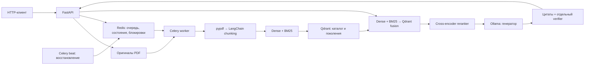

# Document RAG

Backend на FastAPI для независимых вопросов по PDF до 100 страниц. Celery индексирует
документ через Redis; Qdrant объединяет dense и BM25 поиск, отдельный реранкер отбирает
контекст. Ответ проходит Pydantic, проверку точных цитат и отдельный вызов LLM-verifier.
Истории диалога и пользовательского интерфейса нет.

Требования: [testtask.txt](testtask.txt). Файл восстановлен без изменения текста из
Git-истории родительского проекта (`8391d096`, путь `testtask.txt`), поскольку в этой
рабочей копии его не было. Результаты контрольного запуска: [JSON-отчёт](docs/reviewer-results.json).

## Запуск

### Docker Compose с NVIDIA

Нужны Linux или WSL2, NVIDIA GPU с драйвером для CUDA 12.6, NVIDIA Container Toolkit,
Docker Engine и Compose **v2.24+** (`env_file.required`). Команды ниже рассчитаны на
POSIX shell и выполняются из корня репозитория. Для HTTP-примеров нужен `curl`.
Первый запуск требует интернета для Python-пакетов и публичных весов Hugging Face/Ollama.
При обработке документов inference локальный. Фиксированного подтверждённого минимума
RAM/VRAM нет: учитывайте одновременно Ollama, API, worker и загрузку моделей.

```sh
cp .env.example .env
# При обновлении сохраняйте существующий .env.
docker compose --profile app --profile inference config --quiet
docker compose --profile app build api
docker run --rm --user "$(id -u):$(id -g)" \
  -v "$PWD:/workspace" -w /workspace document-rag:cuda rag init-api-key
docker compose --profile inference up -d redis qdrant ollama
docker compose --profile app run --rm api rag download-models
docker compose --profile app run --rm api rag init
docker compose --profile app --profile inference up -d --no-build
docker compose exec -T api rag doctor
curl --fail-with-body http://localhost:8000/health/ready
```

`api`, `worker` и `scheduler` используют один образ `document-rag:cuda`, поэтому
достаточно собрать `api`. UID/GID в команде генерации ключа нужны для записи `.env`
на Linux: пользователь образа `10001` не обязан иметь права на рабочую копию.
Ключ генерируется один раз, существующий не заменяется; файл получает права `0600`.

`download-models` сохраняет dense/reranker и их commit в `rag-model.json`, подготавливает
BM25 и скачивает генератор/verifier через Ollama (один раз, если имена совпадают).
Приложение само веса не скачивает. `init` создаёт/проверяет коллекцию Qdrant и
payload-only каталог. `doctor` проверяет Redis, схему Qdrant, маркеры весов и локальные
модели Ollama; это **не тест генерации или доступности CUDA**. Если Ollama ещё запускается,
повторите подготовительную команду после его готовности. `depends_on` ожидает здоровье
Redis, но только запуск контейнера Qdrant; зависимости от готовности Ollama нет.

API: `http://localhost:8000`, Swagger: `http://localhost:8000/docs` (кнопка Authorize),
OpenAPI: `http://localhost:8000/openapi.json`.

| Сервис | Профиль | Порт на localhost | Постоянные данные |
|---|---|---|---|
| `redis` | без профиля | `6379` | volume `redis`: AOF; broker DB 0, Celery backend DB 1, состояния/блокировки DB 2 |
| `qdrant` | без профиля | `6333` | volume `qdrant`: одна коллекция, каталог, векторы и исходный текст чанков |
| `ollama` | `inference` | `11434` | volume `ollama`: веса LLM |
| `api` | `app` | `8000` | volume `documents`: PDF; volume `models`: dense/reranker/BM25 |
| `worker` | `app` | — | те же `documents` и `models` |
| `scheduler` | `app` | — | `documents`: файл расписания Celery beat |

Compose выделяет NVIDIA-устройство API, worker и Ollama. API/worker ограничены 4 GiB
RAM каждый, scheduler — 512 MiB; `/tmp` приложения — 512 MiB. Один inference-slot
сериализует этапы моделей API/worker, но не выгружает удерживаемую Ollama модель.

```sh
docker compose --profile app --profile inference ps
docker compose logs --tail=100 api worker scheduler ollama
docker compose exec -T api rag reindex DOC_ID
docker compose --profile app --profile inference down
```

Последняя команда сохраняет данные. Добавление `-v` удаляет volumes. Удаление одного
документа доступно через API; старые поколения хранятся до такого удаления.

### Нативная разработка / macOS без NVIDIA

Штатный Compose GPU-профиль не запускается на Mac. Можно оставить Redis/Qdrant в
Docker, а Python и Ollama запустить на хосте. Нужны **Python 3.12** и установленный
Ollama. Ни Python 3.11, ни 3.13 не входят в поддерживаемый диапазон проекта.

```sh
python3.12 -m venv .venv
. .venv/bin/activate
python -m pip install -e '.[dev]'
cp .env.example .env
rag init-api-key
```

В `.env` установите `RAG_MODEL_DEVICE=cpu`; остальные значения подходят для localhost.
На macOS в контрольном запуске dense/reranker работали на CPU, Ollama — через Metal.
Для полностью CPU-режима также задайте `RAG_OLLAMA_NUM_GPU=0`; скорость такого режима
здесь не измерялась. `mps` допускается конфигурацией, но не проверялся этим аудитом.

В отдельном терминале запустите и оставьте работающим:

```sh
OLLAMA_NO_CLOUD=1 ollama serve
```

Если Ollama уже запущен приложением, второй сервер не нужен. Затем:

```sh
docker compose up -d redis qdrant
rag download-models
rag init
rag doctor
```

В трёх терминалах из корня проекта, с активированной `.venv`:

```sh
uvicorn app.main:app --host 127.0.0.1 --port 8000
celery -A app.workers.celery_app:celery_app worker --loglevel=INFO --pool=solo
celery -A app.workers.celery_app:celery_app beat --loglevel=INFO --schedule=.data/celerybeat-schedule
```

Это три отдельных долгоживущих процесса. `solo` используется для локальной проверки
на macOS; его выполнение и принудительные временные ограничения не эквивалентны
Linux prefork-worker в Compose. API и worker должны читать одинаковый `.env` и иметь
общий каталог PDF/моделей.

## Конфигурация

Все поля и значения по умолчанию перечислены в [.env.example](.env.example), их типы
и взаимные ограничения — в [Settings](app/core/config.py). При нативном запуске
переменные процесса имеют приоритет над `.env`. Единственный обязательный секрет —
`RAG_API_KEY` длиной от 32 символов; без него API не стартует. Внешние API-ключи моделям
не нужны. `.env` не коммитится.

| Группа | Значения по умолчанию и смысл |
|---|---|
| Dense | `intfloat/multilingual-e5-small`, 384 измерения; нормализация, префиксы `query: ` / `passage: ` |
| Sparse | `Qdrant/bm25`, русский stemmer, IDF на стороне Qdrant |
| Chunking | 240 токенов, overlap 35; токенизатор dense-модели, без пересечения страниц |
| Retrieval | dense 40, sparse 40, fusion `rrf` (возможен `dbsf`), итог до 30 |
| Reranker | `cross-encoder/mmarco-mMiniLMv2-L12-H384-v1`, вход 30, выход 5, до 512 токенов на пару |
| LLM | генератор и verifier `qwen2.5:7b-instruct-q4_K_M`, контекст 16384, вывод до 1200 токенов |
| Контекст | до 8000 UTF-8 байт сериализованных цитат; фактически отправленных фрагментов может быть меньше 5 |
| HTTP/PDF | PDF до 50 MiB и 100 страниц; вопрос до 2000 символов по настройкам сервиса; OCR отсутствует |
| Время | LLM-вызов до 300 с; общий ответ 1300 с; worker soft/hard/visibility: 3300/3600/3900 с |
| Повторы | до 3 попыток временных сетевых ошибок, до 3 попыток индексации; коррекция ответа отдельно — ровно одна |

Время в `.env.example` задаётся в секундах, размеры — в байтах, `*_MEMORY_LIMIT_MB` —
в MiB. `RAG_LLM_LOG_OUTPUTS=false` не пишет тексты LLM в логи; diagnostics содержит
текст документа и доступен владельцу общего API-ключа.

Compose переопределяет `RAG_QDRANT_URL`, три Redis URL, `RAG_STORAGE_DIR`,
`RAG_MODEL_CACHE_DIR` и `RAG_OLLAMA_URL` значениями для контейнерной сети/volumes.
Для адреса локального Ollama снаружи контейнера есть отдельная Compose-переменная
`RAG_CONTAINER_OLLAMA_URL`; простая смена `RAG_OLLAMA_URL` в `.env` её не заменяет.
Это не отключает NVIDIA reservations. Изменение параметров индекса/версий библиотек
может дать `409 index_profile_changed`: нужна `rag reindex DOC_ID`. При смене dense
размерности требуется новая совместимая коллекция. При смене модели или revision
нужен новый каталог кеша; `download-models` не перезаписывает несовместимый маркер.

## API и воспроизводимые примеры

Документы и задачи требуют `Authorization: Bearer <RAG_API_KEY>`. Один ключ даёт
доступ ко всем документам установки. Health и OpenAPI/Swagger доступны без ключа.

```sh
export RAG_API_KEY="$(sed -n 's/^RAG_API_KEY=//p' .env)"
```

| Метод и путь | Запрос / успешный ответ |
|---|---|
| `POST /documents` | multipart `file`, необязательный `title`, необязательный `Idempotency-Key`; `202`: `doc_id`, `task_id`, `status_url` |
| `GET /tasks/{task_id}` | `200`: ID задачи/документа/поколения, `status`, `stage`, `attempt`, счётчики чанков, `updated_at`, `error`, `timings_ms` |
| `GET /documents?limit=20&cursor=UUID` | `200`: `items` с ID, названием, статусом, датой, задачей, числом страниц/чанков и `next_cursor` |
| `POST /documents/{doc_id}/questions?diagnostics=false` | JSON `question`; `200`: `answer`, `found`, `citations`; при `true` ещё `diagnostics` |
| `DELETE /documents/{doc_id}` | `204`, пустое тело; при активной индексации `409` |
| `GET /health/live` | `200 {"status":"ok"}`, только процесс |
| `GET /health/ready` | `200 {"status":"ok"}`, Redis и Qdrant; не worker, модели или GPU |

Публичные схемы: [app/contracts.py](app/contracts.py), состояние задачи:
[app/models.py](app/models.py). `section` цитаты может быть `null`. OpenAPI допускает
вопрос до 20000 символов, но сервис дополнительно применяет `RAG_QUESTION_MAX_CHARS`
(по умолчанию 2000) и токенные лимиты моделей.

### 1. Загрузка существующего регламента

Загружается **только PDF**, а не файл с эталонными ответами.

```sh
curl --fail-with-body -X POST http://localhost:8000/documents \
  -H "Authorization: Bearer $RAG_API_KEY" \
  -F 'title=Reviewer: Северный контур' \
  -F 'file=@tests/testdata/severny_kontur_operational_handbook.pdf;type=application/pdf'
```

Ожидается `202`. Подставьте возвращённые идентификаторы:

```sh
DOC_ID='значение doc_id из ответа загрузки'
TASK_ID='значение task_id из ответа загрузки'
curl --fail-with-body -H "Authorization: Bearer $RAG_API_KEY" \
  "http://localhost:8000/tasks/$TASK_ID"
curl --fail-with-body -H "Authorization: Bearer $RAG_API_KEY" \
  'http://localhost:8000/documents?limit=20'
```

Повторяйте GET задачи до `succeeded` или `failed`; до успеха задавать вопросы нельзя.
Статусы: `queued`, `running`, `retrying`, `succeeded`, `failed`. При `failed` смотрите
`error.code`/`message` и worker-логи. Терминальные задачи хранятся 7 дней, активные —
без TTL; отсутствующая/истёкшая задача даёт `404`. Каталог переживает истечение TTL:
`ready` при опубликованном индексе, иначе `status_expired`, если записи задачи нет.

Одинаковые байты и точный заголовок переиспользуют документ. Неуспешная индексация
не перезапускается простым повтором загрузки: используйте `rag reindex`.
`Idempotency-Key` связывает запрос с идентификаторами на 7 дней; конфликт содержимого
даёт `409`. При переиндексации прежнее поколение остаётся сохранённым, но при изменении
профиля старый индекс не обслуживает вопросы до публикации нового.

### 2. Точная сумма и согласующие

Вопрос Q3 из существующего ключа. PDF, страница **11**, раздел **10. Срочная закупка**:
лимит **250 000 рублей**, согласуют **руководитель закупок и операционный директор**.

```sh
curl --fail-with-body -X POST \
  "http://localhost:8000/documents/$DOC_ID/questions?diagnostics=true" \
  -H "Authorization: Bearer $RAG_API_KEY" \
  -H 'Content-Type: application/json' \
  -d '{"question":"Каков лимит одной срочной закупки и кто её согласует?"}'
```

Ожидается `200`, `found=true` и цитаты страницы 11. Полный фактический HTTP-ответ
с идентификаторами и диагностикой находится в `exact.response` [отчёта](docs/reviewer-results.json);
точный метод, URL, заголовки и JSON запроса — в `exact.request`. Секрет заменён маркером.

### 3. Сведения отсутствуют

Вопрос Q27 из ключа. Весь извлечённый текст 37 страниц проверен: документ упоминает
корпоративную почту, но не содержит адреса отдела закупок. Этот вопрос не проверяет
общие знания модели.

```sh
curl --fail-with-body -X POST \
  "http://localhost:8000/documents/$DOC_ID/questions?diagnostics=true" \
  -H "Authorization: Bearer $RAG_API_KEY" \
  -H 'Content-Type: application/json' \
  -d '{"question":"Какой адрес электронной почты отдела закупок?"}'
```

Ожидается `200`, `found=false`, `citations=[]`. Полный фактический JSON —
`absent.response` [отчёта](docs/reviewer-results.json). Ошибка модели/сети не является
корректным отказом: это `502`/`503`/`504`, а не `found=false`.

### Повтор прогона и проверка цитат

Для нативного API и активированной `.venv`:

```sh
python scripts/smoke.py tests/testdata/severny_kontur_operational_handbook.pdf \
  --scenario handbook --output .data/reviewer-results.json
```

Для запущенного Compose, без установки Python на хост:

```sh
docker compose --profile app run --rm --user "$(id -u):$(id -g)" \
  -v "$PWD:/review" -w /review api \
  python scripts/smoke.py tests/testdata/severny_kontur_operational_handbook.pdf \
  --scenario handbook --api-url http://api:8000 --output .data/reviewer-results.json
```

Скрипт проверяет health, загрузку, терминальный статус, оба вопроса, Pydantic,
фактический вызов verifier по диагностике, сумму/согласующих и координаты **всех**
цитат. При ошибке сохраняет отчёт и возвращает ненулевой код; документ оставляет
для ручной проверки. При прерывании процесса до сохранения отчёт может отсутствовать.
Это узкий приёмочный тест; он не заменяет оценку качества на полном наборе вопросов.

Откройте исходный PDF на странице `citation.page` (нумерация с 1), найдите цитируемый
текст и сопоставьте с ответом. `section` — эвристически найденный заголовок, не
авторитетная разметка PDF. `char_start`/`char_end` — полуоткрытый интервал Unicode-
символов **извлечённого текста всего документа**, не байты PDF и не координаты на листе.
Между страницами учитывается один символ `\f`. Проверка в `validate_answer` скрипта
вычитает `page.char_start` и требует `page.text[start:end] == citation.text`, сохраняя
переносы строк. `fragment_id`, документ, страница и заголовок сверяются с контекстом
диагностики; метаданные формирует приложение, а не LLM. HTTP-скачивания оригинала
и получения чанка по ID нет: оригиналы сохраняются в `documents/{doc_id}.pdf` внутри
настроенного каталога хранения (в Compose `/data/documents/{doc_id}.pdf`).

Диагностика показывает dense/sparse/fusion counts, кандидатов с fusion/rerank scores,
результат отбора и реально отправленный контекст, время этапов. Основной поиск —
один `query_points` с двумя `Prefetch` и `FusionQuery`. Counts отдельных ветвей
получены дополнительным `query_batch_points` (`branch_measurement=separate_queries`),
а не из внутреннего prefetch. Дополнительные запросы не участвуют в формировании ответа.

Ошибки приложения имеют вид `{"error":{"code":"...","message":"..."}}`.
Ошибки валидации маршрута FastAPI используют стандартный `{"detail":[...]}`.
Коды: `401` ключ; `404` ресурс; `408` чтение тела; `409` индекс/конфликт/активная задача;
`410` повтор запроса удалённого документа; `413` размер; `415` формат; `422` ввод/лимит;
`429` лимит параллельных HTTP-запросов; `502` невалидный ответ после коррекции;
`503` инфраструктура/веса/занятый inference; `504` срок ответа; `500` неожиданный сбой.

## Архитектура и решения



`api` отвечает за HTTP, auth и ограничение нагрузки; `services` — порядок сценариев;
`processing` — PDF/chunking; `infrastructure` — Qdrant, Redis, файлы и модели;
`workers` — доставка задач и восстановление. Конфигурация — `app/core/config.py`,
публичные контракты — `app/contracts.py`. Реляционной БД нет.

1. **Приём и индексация.** API потоково проверяет PDF-сигнатуру, размер и SHA-256,
   сохраняет оригинал, каталог в Qdrant и задачу в Redis, затем публикует в Celery.
   Worker разбирает PDF в отдельном процессе с таймаутом и Linux-лимитом памяти.
   LangChain splitter сохраняет страницы, разделы, точные срезы текста и offsets.
   Dense-модель и FastEmbed BM25 работают через LangChain. Оба вектора и обязательные
   поля payload записываются в одну точку; точки всех документов — в одной коллекции.
2. **Поколения вместо частичного индекса.** Детерминированный ID зависит от документа,
   поколения и номера чанка. Повторная доставка не дублирует чанки. Полнота payload,
   обоих векторов и количества точек проверяется до переключения `active_generation`.
   Каталог — отдельные payload-only точки той же коллекции: это позволяет показывать
   ещё не готовые документы. Поиск фильтруется по `doc_id` и поколению в обеих ветвях;
   поля фильтров индексированы. Между файловой системой, Redis и Qdrant нет общей транзакции.
3. **Поиск и ответ.** E5 даёт семантические совпадения, BM25 сохраняет точные обозначения.
   Серверный fusion объединяет ветви; cross-encoder переоценивает пары вопрос/фрагмент.
   Только верхние кандидаты, помещающиеся в контекст, доступны генератору. Модель
   выбирает ID дословных отрывков; приложение восстанавливает цитаты, затем проверяет
   схему, принадлежность контексту, точный текст и координаты.
4. **Независимая проверка.** Новый вызов verifier получает вопрос, черновик и контекст,
   проверяет поддержку каждого утверждения именно его evidence, полноту и ответ на
   вопрос. `found=false` тоже проверяется. Независимость означает отдельный вызов и
   инструкции; по умолчанию это **та же модель**, а не независимый источник знаний.
   При неверной структуре/цитате/grounding разрешена одна коррекция на том же контексте
   и повтор всех проверок. Повторная неудача даёт `502`.
5. **Сбои и конкуренция.** Для временных отказов Qdrant/Ollama есть ограниченные повторы
   с backoff. Celery использует late ack, ограничение попыток и Redis-state; beat
   сверяет зависшие задачи с опубликованным поколением. Продлеваемые document leases
   защищают изменения; Redis-slot и файловая блокировка ограничивают inference между
   API/worker. Лимит HTTP-запросов локален процессу API. Общий deadline проверяется
   между этапами, но не прерывает немедленно зависшую CPU/GPU-операцию.

## Ограничения и production

**Реализовано:** локальный inference, проверяемая привязка цитат, отдельный verifier,
ограничения размера/времени/конкуренции, API-ключ, восстановление задач, постоянные
volumes и явное удаление. Это не означает production-ready.

**Фактические ограничения и долг:**

- Нет OCR: любая страница без текста, даже пустая внутри текстового PDF, отклоняет
  документ. Зашифрованные PDF не поддерживаются. Таблицы и заголовки извлекаются
  эвристически; порядок и качество текста зависят от PDF.
- Проверка LLM вероятностная. Отказ означает нехватку сведений в выбранном контексте,
  а не доказанное отсутствие во всём документе; возможны пропуски retrieval и ложные
  отказы. Нет калиброванного relevance threshold. Верификатор может повторить ошибку
  генератора. Два контрольных вопроса не дают метрику точности.
- `requirements.lock` — существующий снимок Linux/CUDA-зависимостей, **Dockerfile его
  не использует**; `pip install .` разрешает диапазоны из `pyproject.toml`. Модели с
  revision `main`, теги Docker/Ollama и незакреплённый базовый образ не обеспечивают
  повторяемость между датами. Commit dense/reranker фиксируется лишь при скачивании.
- Нет общей транзакции: crash между записью каталога и регистрацией задачи может
  потребовать повторной загрузки/`reindex`. Reconciliation видит зарегистрированные
  активные задачи, а не все возможные расхождения хранилищ. Автоочистки старых поколений,
  потерянных временных файлов и дисковых квот нет.
- Readiness не проверяет worker, модель или accelerator. Лимиты RAM заданы без
  нагрузочного подтверждения; загрузка/выгрузка dense и reranker на каждом запросе
  повышает задержку. SLA и пропускная способность не установлены.
- Один общий ключ, без пользователей/tenant isolation/TLS. Redis/Qdrant доступны с
  хоста без auth, порты привязаны к loopback. Production-мониторинга, backup/restore
  процедуры, CI и доказанной отказоустойчивости нет.

**До production:** закрепить и регулярно проверять сборки/веса с hashes и CI;
оценить retrieval и ответы на размеченном наборе (включая отказы, таблицы, prompt injection);
провести нагрузочные/аварийные тесты, измерить RAM/VRAM/latency и настроить лимиты;
добавить метрики и алерты по очередям/ошибкам/этапам, readiness inference; обеспечить
согласование хранилищ и восстановление из backup, retention/квоты; ввести TLS,
разграничение доступа и секреты по средам. OCR добавлять только при необходимости
соответствующих документов, с повторной проверкой цитат.

## Проверки

После установки Python dev-зависимостей по инструкции выше:

```sh
python -m pytest
python -m ruff check .
python -m ruff format --check .
python -m mypy app
python -m pip check
```

По умолчанию интеграционные тесты пропускаются. С подготовленным стеком/моделями,
одинаковыми настройками API и тестов:

```sh
RAG_RUN_INTEGRATION=1 python -m pytest tests/integration/test_qdrant.py
RAG_RUN_STACK_TESTS=1 python -m pytest tests/integration/test_worker.py
RAG_RUN_MODEL_TESTS=1 python -m pytest tests/integration/test_ollama.py
RAG_RUN_HANDBOOK_TESTS=1 python -m pytest tests/integration/test_handbook.py
# Только на NVIDIA CUDA:
RAG_RUN_GPU_TESTS=1 python -m pytest tests/integration/test_gpu.py
```

Тесты Qdrant создают и удаляют собственные коллекции; worker/handbook — свои документы.
`RAG_TEST_API_URL` меняет адрес API, `RAG_TEST_REPORT_DIR` — каталог отчётов handbook
(по умолчанию `/tmp/handbook-results`). Handbook-тесты дополнительно сравнивают ответ
с эталоном через LLM; это тоже вероятностная оценка. Для нативного клиента при Compose
не подставляйте в `.env` внутренние имена `qdrant`/`redis`/`ollama`: нужны опубликованные
localhost-порты. GPU-тестам дополнительно нужны доступные локальные кеши dense/reranker.

Прежний маленький smoke и GPU-benchmark сохранены:

```sh
python scripts/create_example.py .data/example.pdf
python scripts/smoke.py .data/example.pdf --output .data/smoke-results.json --warm
python scripts/benchmark_gpu.py --api-url http://localhost:8000
```

Последняя команда требует `nvidia-smi`. Измерений GPU-бенчмарка этим аудитом нет.

### Результаты аудита

<!-- AUDIT_RESULTS -->

## Тестовые материалы

| Файл в `tests/testdata/` | Содержание |
|---|---|
| `severny_kontur_operational_handbook.pdf` | синтетический регламент, 37 страниц |
| `severny_kontur_qa.txt` | 25 вопросов с ответами и 5 без ответа; не загружать в индекс |
| `computer_networks_part_1_pages_1-100.pdf` | пособие «Компьютерные сети», 100 страниц |
| `computer_networks_qa_sequential.txt` | вопросы и ответы по пособию; не загружать в индекс |

При аудите оба PDF прошли штатный parser. Полный прогон вопросов по пособию и
индексация его 100 страниц отдельно не выполнялись; тест `test_hundred_text_pages`
проверяет лимит/offsets на 100 синтетических страницах. Исходные материалы не изменены.
